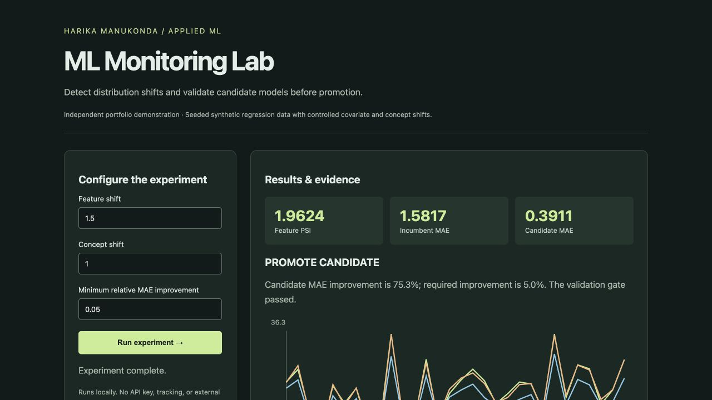
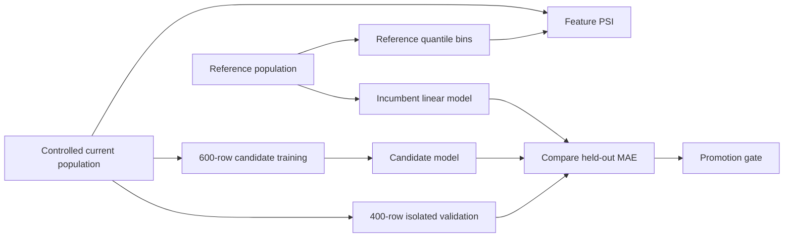

# ML Monitoring Lab



A reproducible monitoring experiment that separates feature drift from model degradation, retrains a candidate, and applies a validation gate before simulated promotion.



## Experiment design

A reference regression population trains the incumbent on 1,000 rows. The current population introduces an adjustable mean shift in feature 0 and an adjustable change in its target coefficient. A candidate trains on the first 600 current rows; both models are evaluated on the remaining 400 rows. A SHA-256 fingerprint identifies each model's weights in the response.

PSI uses reference-population quantile bins, with unbounded outer bins and epsilon smoothing for empty bins. A value above 0.2 triggers the demo feature-drift flag. **This is a configurable heuristic, not a statistical significance test or universal production threshold.** Only feature 0 is monitored in this experiment.

A candidate passes the gate when its validation MAE is strictly lower and its relative improvement meets the configured minimum. Drift alone never promotes a candidate. The application reports a decision but does not persist or deploy model changes.

## Data and limitations

All data are seeded synthetic regression samples. Labels are assumed immediately available, unlike many operational systems. The split is independent sampling rather than a temporal stream. There is no persistent registry, alert delivery, production endpoint instrumentation, or automated deployment. No employer data or production performance claims are included.

The next stage is delayed-label evaluation, slice-based quality gates, multiple monitored features, a persistent event log, and a separate audited promotion action.

## Example API request

```sh
curl http://127.0.0.1:8003/api/run -H 'Content-Type: application/json' -d '{"feature_shift":1.5,"concept_shift":1,"min_improvement":0.05}'
```

## Verification

Tests check zero PSI for identical distributions, positive drift under shift, rejection of regressions and insufficient gains, stable no-shift behavior, candidate improvement, and invalid input.

## Run locally

Requires Python 3.10 or later.

```sh
python3 -m venv .venv
source .venv/bin/activate
python -m pip install -r requirements.txt
python -m unittest discover -s tests -v
python demo.py
python app.py --port 8003
```

Open [the local dashboard](http://127.0.0.1:8003). Submit the form to run an experiment. The dashboard uses no remote fonts, scripts, or API services. `GET /health` provides a liveness check, and `POST /api/run` returns the experiment as JSON. Invalid inputs return HTTP 400.

`python demo.py` reproduces `reports/example.json`. That report contains measured outputs from the checked-in implementation, not hand-written performance claims.

## Containerized experiment

```sh
docker build -t ml-monitoring-lab .
docker run --rm ml-monitoring-lab
```

The default container runs the reproducible experiment and prints JSON; it does not expose an HTTP port.

## Repository map

- `core.py`: algorithms, validation, and experiment orchestration.
- `app.py`: loopback-only HTTP demo server with bounded request sizes.
- `web/index.html`: interactive dashboard with escaped text rendering.
- `tests/`: behavior and failure-case checks.
- `reports/example.json`: reproducible example output.
- `.github/workflows/checks.yml`: test and demo checks on pushes and pull requests.

## Intended use

Independent educational portfolio project by Harika Manukonda. The local server is a demonstration server, with no authentication or production hardening. Bindings are restricted to loopback. Keep it local; a public deployment requires a production server, access controls where appropriate, request limits, and operational monitoring. Dependency versions are bounded but not lockfile-pinned; cross-version numerical fingerprints may vary slightly.

Licensed under MIT.
